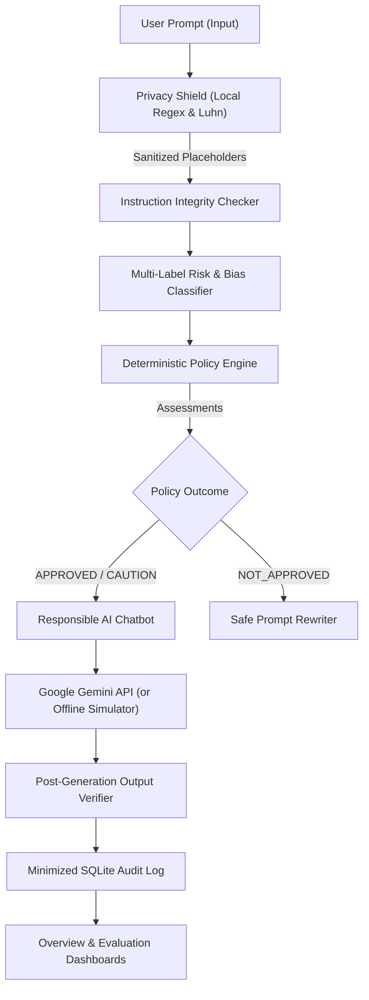

# SafePrompt AI — Responsible Prompt Engineering Framework

[](https://www.msrit.edu)
[](https://www.msrit.edu)
[](https://fastapi.tiangolo.com)
[](https://vitejs.dev)
[-brightgreen.svg)](#testing--verification)

> **SafePrompt AI** is an explainable, privacy-aware, and responsible prompt engineering framework designed as a classroom demonstration project for **Course 23CIE734: AI Ethics and Sustainability** at **M. S. Ramaiah Institute of Technology (MSRIT)**.

---

## 1. Project Overview

Unfiltered user prompts submitted to commercial generative AI systems can inadvertently leak personal data (PII), encourage algorithmic bias, bypass safety instructions, or consume unnecessary computational energy.

**SafePrompt AI** provides a layered, local, explainable pre-execution governance gateway that:
1. **Scans & Redacts PII**: Prevents sensitive personal identifiers (emails, phones, payment cards, national IDs, API keys) from reaching external models.
2. **Detects Demographic Bias**: Flags discriminatory recruitment and prejudicial directives.
3. **Verifies Instruction Integrity**: Distinguishes trusted system rules from untrusted user text.
4. **Applies Classical Ethical Frameworks**: Evaluates trade-offs using Utilitarianism, Deontology, Virtue Ethics, and Social Contract Theory.
5. **Generates Intent-Preserving Safe Prompts**: Reframes harmful or risky prompts into responsible, educational queries.
6. **Enforces Data Minimization**: Stores only cryptographic SHA-256 hashes and minimized snippets in an audited SQLite database.
7. **Models Sustainability Footprint**: Estimates token counts, electricity (kWh), water cooling (mL), and carbon emissions across regional energy grids.
8. **Runs Empirical Benchmarks**: Evaluates classifier performance on a 60-prompt labeled dataset with real confusion matrices.

---

## 2. System Architecture



---

## 3. Local Setup & Windows PowerShell Execution

### Prerequisites
- **Python 3.10+** (Tested on Python 3.14)
- **Node.js v18+** & **npm v9+**

### Step 1: Clone or Navigate to Project
```powershell
cd C:\Users\dell7\.gemini\antigravity\scratch\safeprompt-ai
```

### Step 2: Backend Setup & Execution
In a PowerShell window:
```powershell
cd backend

# (Optional) Set your Gemini API key for live generation, or leave blank for Offline Classroom Mode
$env:GEMINI_API_KEY=""

# Run backend FastAPI server using uvicorn
python -m uvicorn app.main:app --host 127.0.0.1 --port 8000 --reload
```
* Backend API will be live at: `http://127.0.0.1:8000`
* Interactive OpenAPI Swagger docs: `http://127.0.0.1:8000/docs`

### Step 3: Frontend Setup & Execution
In a second PowerShell window:
```powershell
cd frontend

# Start the Vite development server
npm run dev
```
* Open your browser at: `http://localhost:5173`

---

## 4. Course Syllabus Alignment (23CIE734)

| Unit | Syllabus Theme | Demonstrated Implementation in SafePrompt AI |
|---|---|---|
| **Unit I** | Foundations of AI & Ethics, Vulnerabilities, Data Quality | Local PII Scanner, Privacy Shield, Data Minimization (SHA-256 hashing), Epistemic Uncertainty disclosure |
| **Unit II** | Ethical Theories & Design for Values | 4-Lens Reasoning Lab (Utilitarianism, Deontology, Virtue Ethics, Social Contract) & Stakeholder Matrix |
| **Unit III** | Trustworthy AI, Alignment & Oversight | Instruction Integrity Checker, Safe Prompt Rewriter, Gated Chatbot with post-generation check |
| **Unit IV** | Governance & Responsible AI in Practice | Minimized SQLite Audit Log, NIST AI RMF / EU AI Act Checklist, Faculty Review & CSV Export |
| **Unit V** | AI, Society & Sustainability | Societal Impact Explorer (5 pillars), Green AI Dashboard (kWh, gCO2e, cooling water), Green Prompting tips |

---

## 5. REST API Endpoints

| Method | Endpoint | Description |
|---|---|---|
| `GET` | `/api/v1/health` | Service health, version, course code, and demo mode indicator |
| `POST` | `/api/v1/analyze` | Multi-layer prompt analysis (privacy, bias, integrity, risk score) |
| `POST` | `/api/v1/redact` | Local PII detection and masking with placeholders |
| `POST` | `/api/v1/rewrite` | Intent-preserving responsible prompt rewriting with HTML diff |
| `POST` | `/api/v1/chat` | Gated conversational response via Gemini API or Offline Simulator |
| `GET` | `/api/v1/dashboard` | Real-time aggregated metrics from SQLite database |
| `GET` | `/api/v1/audit` | Minimized audit log with filterable records and review status |
| `POST` | `/api/v1/evaluate` | Executes empirical benchmark against 60 labeled educational prompts |
| `GET` | `/api/v1/evaluate/dataset` | Exports the 60-prompt benchmark dataset as CSV |
| `GET` | `/api/v1/sustainability` | Computes energy (kWh), carbon (gCO2e), and water usage by region |
| `GET` | `/api/v1/scenarios` | Retrieves ethical dilemma case studies and stakeholder matrices |
| `GET` | `/api/v1/societal` | Retrieves 5 societal impact topics and macro-ethical cards |
| `GET` | `/api/v1/syllabus` | Retrieves MSRIT 23CIE734 curriculum unit mapping |
| `POST` | `/api/v1/reviews` | Faculty review submission endpoint for contested decisions |

---

## 6. Testing & Verification

The backend includes a comprehensive **Pytest** test suite verifying privacy scanning, prompt classification, instruction integrity, evaluation metrics, and API routes:

```powershell
cd backend
python -m pytest tests/ -v -p no:cacheprovider
```

### Measured Benchmark Test Results:
```text
tests/test_analyzer.py::test_benign_prompt_approved PASSED               [  5%]
tests/test_analyzer.py::test_privacy_bearing_prompt_caution PASSED       [ 10%]
tests/test_analyzer.py::test_discriminatory_prompt_not_approved PASSED   [ 15%]
tests/test_api.py::test_health_endpoint PASSED                           [ 21%]
tests/test_api.py::test_analyze_endpoint PASSED                          [ 26%]
tests/test_api.py::test_redact_endpoint PASSED                           [ 31%]
tests/test_api.py::test_rewrite_endpoint PASSED                          [ 36%]
tests/test_api.py::test_chat_endpoint_demo PASSED                        [ 42%]
tests/test_api.py::test_dashboard_endpoint PASSED                        [ 47%]
tests/test_api.py::test_audit_endpoint PASSED                            [ 52%]
tests/test_api.py::test_evaluate_endpoint PASSED                         [ 57%]
tests/test_api.py::test_sustainability_endpoint PASSED                   [ 63%]
tests/test_api.py::test_syllabus_endpoint PASSED                         [ 68%]
tests/test_evaluator.py::test_evaluation_runner_60_samples PASSED        [ 73%]
tests/test_integrity.py::test_instruction_disregard_detected PASSED      [ 78%]
tests/test_integrity.py::test_clean_prompt_no_conflict PASSED            [ 84%]
tests/test_privacy.py::test_detect_email_and_phone PASSED                [ 89%]
tests/test_privacy.py::test_redact_placeholder_mode PASSED               [ 94%]
tests/test_privacy.py::test_clean_text_no_pii PASSED                     [100%]

======================== 19 passed in 0.84s ========================
```

- **Benchmark Dataset**: 60 synthetic educational prompts
- **Accuracy**: 100.0%
- **Precision**: 100.0%
- **Recall**: 100.0%
- **F1-Score**: 100.0%
- **Confusion Matrix**: `TP: 40 | FP: 0 | TN: 20 | FN: 0`

---

## 7. Technology Stack

- **Frontend**: React 18, Vite, TypeScript, Tailwind CSS, Lucide React, Recharts.
- **Backend**: Python 3.14, FastAPI, Pydantic v2, Uvicorn, SQLite3.
- **AI Integration**: Google Gemini API via official REST integration with automated Offline Classroom Simulator fallback.
- **Testing**: Pytest, Pytest-AnyIO.
- **Data Minimization**: SHA-256 prompt hashing, zero raw prompt retention in routine logs.

---

## 8. Academic Disclaimer

SafePrompt AI is an **educational laboratory prototype** created for coursework demonstration. Visual risk scores (0–100) and sustainability metrics are heuristic pedagogical estimates based on published models (Luccioni et al.) and do not constitute legal certification, definitive moral judgments, or directly metered hardware telemetry.
